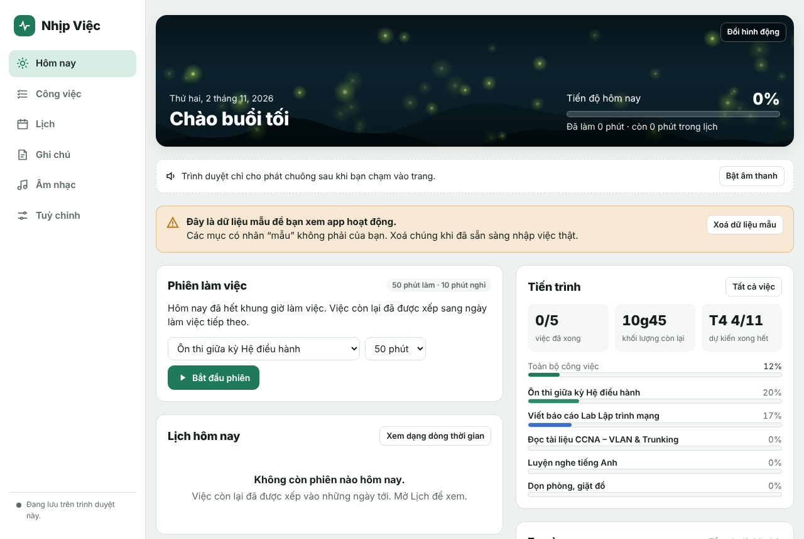
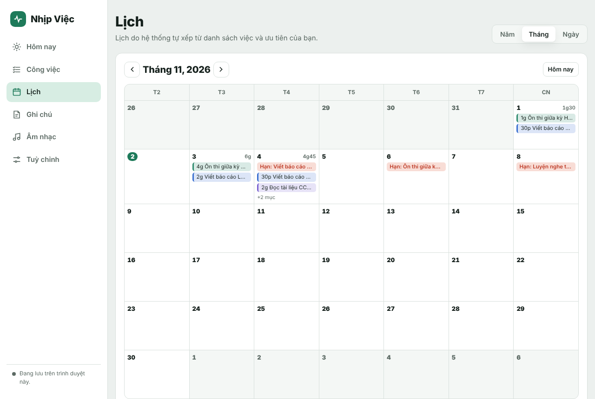
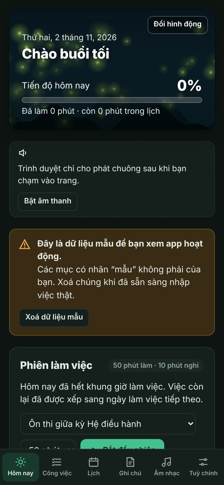

# Nhịp Việc

Ứng dụng ghi chú và lên lịch công việc, giúp bạn không bị quá tải. Bạn chỉ cần nhập việc, thời gian cần làm và thứ tự ưu tiên. Hệ thống tự chia việc thành từng phiên, xen giờ nghỉ và giới hạn số giờ làm mỗi ngày.

**Dùng thử:** https://kidpcongg.github.io/nhip-viec/



## Tính năng

- **Danh sách việc theo ưu tiên.** Kéo thả hoặc bấm ▲▼ để xếp việc nào làm trước. Mỗi việc có thời gian ước lượng, hạn chót, ngày bắt đầu, màu và ghi chú.
- **Tự phân bổ thời gian.** Mỗi việc được chia thành các phiên (mặc định 50 phút làm, 10 phút nghỉ, cứ 4 phiên thì nghỉ dài), không vượt quá số giờ tối đa mỗi ngày. Nếu làm đúng thứ tự mà có việc trễ hạn, hệ thống tự đưa việc đó lên sớm hơn và báo rõ lý do.
- **Cảnh báo quá tải.** Báo trước việc nào sẽ không kịp hạn, kèm gợi ý cách xử lý.
- **Đồng hồ đếm phiên.** Chuông báo khi hết phiên, tự chuyển sang giờ nghỉ.
- **Tiến trình.** Có thanh tiến độ trong ngày, tiến độ từng việc và biểu đồ 7 ngày qua.
- **Lịch năm, tháng, ngày.** Xem khối lượng việc theo ngày, các hạn chót và dòng thời gian chi tiết.
- **Ghi chú.** Có tìm kiếm, ghim và chọn màu.
- **Âm nhạc.** Thêm tệp nhạc trên máy để nghe trong lúc làm. Có thể tự phát khi bắt đầu phiên và dừng khi tới giờ nghỉ.
- **Hình động.** Có 6 cảnh sẵn (đom đóm, mưa, trời sao, bong bóng, lá thu, sóng biển), hoặc tải GIF/video của bạn lên.
- **Cài như app, dùng được khi không có mạng.**

| Lịch tháng | Điện thoại, chế độ tối |
|---|---|
|  |  |

## Cài lên điện thoại

- **Android (Chrome):** mở link dùng thử, vào menu ⋮ rồi chọn *Cài đặt ứng dụng* hoặc *Thêm vào màn hình chính*.
- **iPhone (Safari):** mở link, bấm nút Chia sẻ rồi chọn *Thêm vào MH chính*.
- **Máy tính (Chrome, Edge):** bấm biểu tượng cài đặt ở thanh địa chỉ, hoặc vào trang Tuỳ chỉnh và chọn *Cài ứng dụng*.

## Dữ liệu của bạn ở đâu?

Mọi thứ (việc, ghi chú, lịch sử làm việc, nhạc) **chỉ lưu trên trình duyệt của bạn**. App không có máy chủ, không có tài khoản, và không gửi dữ liệu đi đâu cả. Vì vậy:

- Mở app trên máy khác sẽ thấy danh sách trống.
- Xoá dữ liệu trình duyệt sẽ mất danh sách. Nên thỉnh thoảng vào **Tuỳ chỉnh, Sao chép bản sao lưu** để lưu lại. Khi cần thì dán vào *Khôi phục từ bản sao lưu*.

## Giới hạn đã biết

- Chuông hết phiên chỉ kêu khi app đang mở. Để ở tab nền thì vẫn kêu, nhưng đóng app hoặc máy ngủ thì không.
- Trên điện thoại, nhạc có thể dừng khi khoá màn hình. Việc này tuỳ trình duyệt.
- Không phát được link YouTube hay Spotify, chỉ phát được tệp nhạc có sẵn trên máy.
- Lần đầu mở, app hiện sẵn vài việc mẫu để bạn xem cách hoạt động. Bấm *Xoá dữ liệu mẫu* để bắt đầu.

## Góp ý

Gặp lỗi hoặc có ý tưởng, hãy mở một [Issue](https://github.com/KidPcongg/nhip-viec/issues). Nhớ ghi rõ bạn dùng máy gì và trình duyệt gì.

## Dành cho người phát triển

Viết bằng HTML, CSS và JavaScript thuần, không dùng framework, không cần bước build.

| Phần | Công nghệ |
|---|---|
| Lưu việc, ghi chú, cài đặt | `localStorage` |
| Lưu nhạc | IndexedDB |
| Hình động | Canvas 2D |
| Chuông | Web Audio API (tự tạo âm, không cần tệp âm thanh) |
| Cài app, dùng khi offline | Web App Manifest và Service Worker (`sw.js`) |

Chạy thử trên máy:

```bash
python3 -m http.server 8000
# rồi mở http://localhost:8000
```

Khi sửa `index.html`, hãy tăng `VERSION` trong `sw.js` để người đã cài app nhận bản mới.
